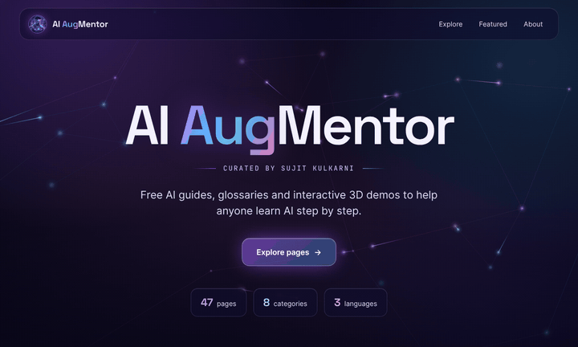

  

<em>Curated by Sujit Kulkarni</em>

I bring 14+ years of investment banking operations experience to practical AI. I build AI automations that solve real workflow problems, and I create free visual learning material so anyone can understand AI step by step.

---

## 🧭 About me

- 🏦 **14+ years in investment banking operations**, specialising in exchange-traded derivatives, data control and change projects at a global investment bank
- 🤖 **Builds AI automations** for operations teams, from structured prompts to low-code workflows
- 🎓 **Mentors colleagues and beginners** on AI fundamentals, and runs beginner coding and AI sessions
- 🌐 **Creator of [AI AugMentor](https://sujitkulkarni09.github.io/sujitkulkarni.github.io)**, a free AI learning hub with 47 pages in English, Hindi and Kannada

---

## 🛠️ Skills and tools

**AI concepts:** generative AI · large language models · prompt engineering · agentic AI · RAG · neural network, ML and deep learning fundamentals

**Finance domain:** exchange-traded derivatives · static data · data control · trade clearing · trade reconciliation · change and testing

---

## ⭐ Featured project

### [AI AugMentor](https://sujitkulkarni09.github.io/sujitkulkarni.github.io) · [repo](https://github.com/SujitKulkarni09/sujitkulkarni.github.io)

A free, searchable hub of AI guides, glossaries and interactive 3D demos.

- **47 pages** across **8 categories**, from AI basics to agentic AI, RAG and harness engineering
- Interactive and 3D visual demos that explain how AI works
- Content in **English, Hindi and Kannada**
- Self-contained HTML, CSS and JavaScript, hosted for free on GitHub Pages

---

## 🔭 Currently

- 🧪 Exploring **LLM evaluation** and **agent memory**, with hands-on projects coming to this profile
- 📚 Preparing for **Microsoft AI certifications**
- 🗣️ Teaching coding and AI basics to complete beginners

## 💬 Ask me about

AI for operations teams · explaining AI to non-technical people · prompt design · low-code automation · derivatives operations

---

Views are my own. Content is independent and educational, and is not affiliated with any employer or AI vendor.
